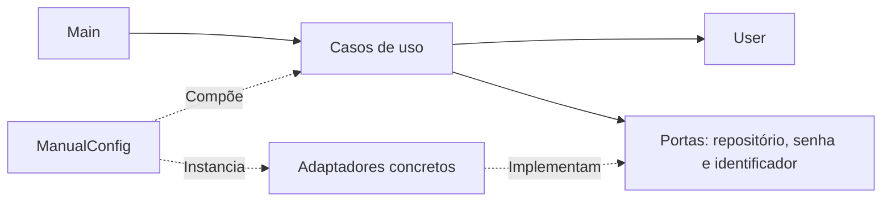

# Clean Architecture em Java

**Cadastro, consulta e login de usuários com regras de aplicação separadas dos detalhes de infraestrutura.**

Exemplo acadêmico em Java 21. O projeto organiza entidades, casos de uso e contratos em camadas e monta as dependências manualmente. A demonstração funciona no terminal, com repositório em memória, geração de identificadores UUID e um adaptador de codificação de senha.

[Arquitetura](#arquitetura) · [Demonstração](#o-que-a-demonstração-executa) · [Executar](#como-executar) · [Testes](#testes-e-evolução)

## O que a demonstração executa

O método `Main` configura os componentes e percorre quatro ações: cria um usuário de exemplo, consulta esse usuário pelo identificador, lista os usuários e verifica o login. As saídas são apresentadas no console.

| Caso de uso | Responsabilidade |
| --- | --- |
| `CreateUser` | Criar o usuário usando as dependências recebidas. |
| `FindUser` | Consultar por identificador e listar usuários. |
| `LoginUser` | Executar a verificação de login. |

Não há servidor HTTP, interface gráfica ou banco externo na demonstração atual.

## Arquitetura



Os casos de uso trabalham com contratos. A montagem em `ManualConfig` escolhe as implementações: armazenamento em memória, UUID e SHA-256 por Commons Codec. Essa separação permite estudar a troca de um adaptador sem transformar o caso de uso em código de infraestrutura.

| Pacote | Conteúdo |
| --- | --- |
| [`entity`](src/main/java/br/ifg/urutai/entity/) | Entidade `User`. |
| [`usecase`](src/main/java/br/ifg/urutai/usecase/) | Casos de uso, validadores e exceções. |
| [`usecase/port`](src/main/java/br/ifg/urutai/usecase/port/) | `UserRepository`, `PasswordEncoder` e `IdGenerator`. |
| [`adapter`](src/main/java/br/ifg/urutai/adapter/) | Implementações concretas das portas. |
| [`config`](src/main/java/br/ifg/urutai/config/) | Composição manual das dependências. |
| [`application`](src/main/java/br/ifg/urutai/application/) | Programa de demonstração. |

## Como executar

### Requisitos

JDK 21. O fluxo Maven documentado utiliza Maven 3.9 ou superior. O repositório também contém `commons-codec-1.17.1.jar`, utilizado pela implementação do encoder.

```bash
git clone https://github.com/dlr-1337/clean-architecture.git
cd clean-architecture
```

### Compilação direta — Bash

É possível compilar o exemplo com o JAR já versionado:

```bash
mkdir -p out
javac -encoding UTF-8 -cp commons-codec-1.17.1.jar -d out $(find src/main/java -name '*.java')
java -cp 'out:commons-codec-1.17.1.jar' br.ifg.urutai.application.Main
```

No Windows, o separador do classpath é `;`, em vez de `:`. Também é possível abrir o projeto em uma IDE e executar `br.ifg.urutai.application.Main` com o JAR no classpath.

### Fluxo Maven do projeto

```bash
mvn clean package
mvn dependency:copy-dependencies -DincludeScope=runtime -DoutputDirectory=target/dependency
java -cp 'target/clean-architecture-1.0.0.jar:target/dependency/*' br.ifg.urutai.application.Main
```

No PowerShell, use o classpath `"target/clean-architecture-1.0.0.jar;target/dependency/*"`.

A resolução das dependências depende das coordenadas registradas no [`pom.xml`](pom.xml). Se o Maven falhar nessa etapa, confira a dependência Commons Codec declarada no POM; o fluxo com o JAR local permite estudar a aplicação sem depender dessa resolução. A revisão deste README não altera dependências nem certifica o build.

## Limites da demonstração

O repositório em memória não preserva os usuários após o encerramento do processo. Os dados e a senha no `Main` são exemplos e não devem ser substituídos por credenciais reais versionadas.

O adaptador `Sha256PasswordEncoder` existe para demonstrar a porta de codificação. O projeto não deve ser apresentado como uma solução completa de autenticação pronta para produção: não implementa, por este exemplo, gestão de sessões, recuperação de conta ou uma política de proteção de credenciais.

## Testes e evolução

JUnit 5 e Maven Surefire estão configurados no POM:

```bash
mvn test
```

Configurar o runner não significa que todos os casos de uso estejam cobertos. As extensões originalmente propostas para o estudo são adicionar testes dos cenários de sucesso e erro, implementar persistência por outra versão de `UserRepository` e expor os mesmos casos de uso por uma interface HTTP ou CLI.

Para acompanhar o fluxo completo, comece por [`Main.java`](src/main/java/br/ifg/urutai/application/Main.java) e depois siga a composição em [`ManualConfig.java`](src/main/java/br/ifg/urutai/config/ManualConfig.java).
